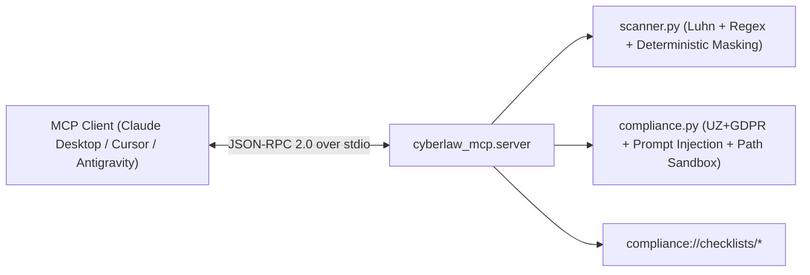

# CyberLaw MCP Server (`cyberlaw-mcp-server`)

A pure-Python **Model Context Protocol (MCP)** server (`JSON-RPC 2.0` over `stdio`) built for **AI privacy, PII redaction, and compliance auditing** aligned with Uzbekistan's Law on Personal Data (`LRU-547`), GDPR data minimization, and OWASP LLM Top 10 guardrails.

> Zero external dependencies required for core scanning and MCP transport (`pypdf` optionally enables `.pdf` inspection).

## Architecture



## Features

- **4 MCP Tools** (`tools/list`, `tools/call`):
  - `scan_pii`: Detects emails, Uzbekistan `+998` & international phones, context-verified Uzbekistan PINFL (`JSHSHIR`) & passports, Luhn-validated payment cards, API keys (`sk-`, `AIza`, `ghp_`, `Bearer`), JWTs, and IPv4s.
  - `redact_pii`: Deterministically replaces sensitive spans with typed placeholders (`[EMAIL_1]`, `[PHONE_UZ_1]`, `[API_KEY_1]`).
  - `audit_ai_prompt_compliance`: Scores prompt privacy/security (`0–100`), flags prompt-injection attempts (EN/RU), and checks log-retention & cross-border risks.
  - `check_file_compliance`: Audits `.txt`, `.md`, `.json`, `.csv`, `.py`, and `.pdf` files with strict `allowed_root` path-traversal protection.
- **2 MCP Resources** (`resources/list`, `resources/read`):
  - `compliance://checklists/uz-personal-data`
  - `compliance://checklists/llm-security-owasp`

## Quickstart

```bash
# Run automated test suite
python -m unittest discover -s tests -v

# Run end-to-end stdio MCP client demo
python client_demo.py
```

## MCP Client Configuration (Claude Desktop / Cursor / Antigravity)

```json
{
  "mcpServers": {
    "cyberlaw-guard": {
      "command": "python",
      "args": ["-m", "cyberlaw_mcp.server", "--root", "."]
    }
  }
}
```
